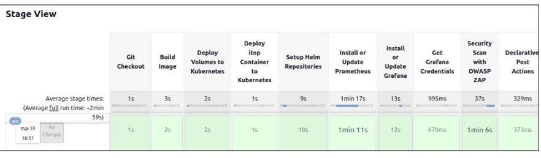

# ⚙️ DevOps CI/CD & GitOps Pipeline — iTop

### Mise en place d'une chaîne DevOps pour le déploiement et la supervision d'iTop sur Kubernetes

## 📌 Présentation du projet

Projet de fin d'études réalisé au sein de **TunTrust (ANCE)**, portant sur la mise en place d'une infrastructure DevOps pour automatiser le déploiement et améliorer l'exploitation de l'application **iTop**.

Le projet s'appuie sur une architecture conteneurisée et une chaîne CI/CD intégrant Jenkins, GitLab CI et ArgoCD, avec Kubernetes pour l'orchestration des conteneurs.

Une solution de monitoring et de logging basée sur Prometheus, Grafana et Loki a également été mise en place afin d'améliorer l'observabilité de l'infrastructure.

## 🎯 Objectifs du projet

- Automatiser le processus de construction et de déploiement de l'application iTop.
- Mettre en place une chaîne CI/CD intégrant les pratiques GitOps.
- Déployer et orchestrer les conteneurs avec Kubernetes.
- Assurer le suivi des performances et de la disponibilité de l'application.
- Centraliser la collecte et la visualisation des métriques et des logs.

## 🏗️ Architecture DevOps

### 1. Conteneurisation de l'application

- Déploiement de l'application **iTop 2.7.6** dans un environnement conteneurisé.
- Utilisation de **Docker** pour isoler les composants applicatifs.
- Intégration de **MariaDB** pour la gestion des données.
- Administration de la base de données via Adminer.

### 2. CI/CD & GitOps

Mise en place d'une chaîne d'intégration et de déploiement continus pour automatiser le cycle de vie de l'application.

- **Jenkins :** automatisation des étapes du pipeline CI/CD.
- **GitLab CI :** intégration des étapes de validation et de construction.
- **ArgoCD :** synchronisation de l'état du cluster Kubernetes avec les configurations déclaratives stockées dans Git.
- **Kubernetes :** orchestration des conteneurs et gestion du déploiement de l'application.

### 3. Orchestration Kubernetes

- Déploiement de l'application iTop sur un cluster Kubernetes.
- Gestion des ressources et des services Kubernetes.
- Mise en place de l'**Horizontal Pod Autoscaler (HPA)** pour adapter le nombre de réplicas à la charge.
- Amélioration de la disponibilité et de la gestion des ressources applicatives.

### 4. Monitoring & Logging

Mise en place d'une solution d'observabilité pour surveiller l'infrastructure et faciliter le diagnostic des incidents.

| Outil | Rôle |
|---|---|
| **Prometheus** | Collecte et stockage des métriques. |
| **Grafana** | Visualisation des métriques et création de tableaux de bord. |
| **Loki** | Centralisation et consultation des logs. |

## 🔄 Fonctionnement global

1. Le code source et les configurations sont versionnés dans Git.
2. Jenkins et GitLab CI exécutent les étapes automatisées du pipeline.
3. Les configurations de déploiement sont synchronisées avec le cluster par ArgoCD.
4. Kubernetes orchestre les conteneurs et assure le fonctionnement de l'application.
5. Prometheus collecte les métriques, Loki centralise les logs et Grafana permet leur visualisation.

## 🛠️ Technologies utilisées

| Catégorie | Technologies |
|---|---|
| Application | iTop 2.7.6 |
| Conteneurisation | Docker |
| Orchestration | Kubernetes, HPA |
| CI/CD | Jenkins, GitLab CI |
| GitOps | ArgoCD |
| Base de données | MariaDB |
| Administration BDD | Adminer |
| Monitoring | Prometheus, Grafana |
| Logging | Loki |

## 🚀 Résultats et réalisations

- Mise en place d'une chaîne CI/CD pour automatiser le déploiement d'iTop.
- Intégration des pratiques GitOps avec ArgoCD.
- Orchestration de l'application conteneurisée sous Kubernetes.
- Mise en place de l'autoscaling horizontal avec HPA.
- Déploiement d'une solution centralisée de monitoring et de logging.
- Amélioration de l'observabilité et de la gestion de l'infrastructure.

## 📸 Démonstration

  

## 👩‍💻 Expérience professionnelle

**Stage de fin d'études (PFE) — DevOps**

**TunTrust (ANCE)** | Janvier – Juin 2024

---

*Projet réalisé dans le cadre du cycle ingénieur en informatique.*
